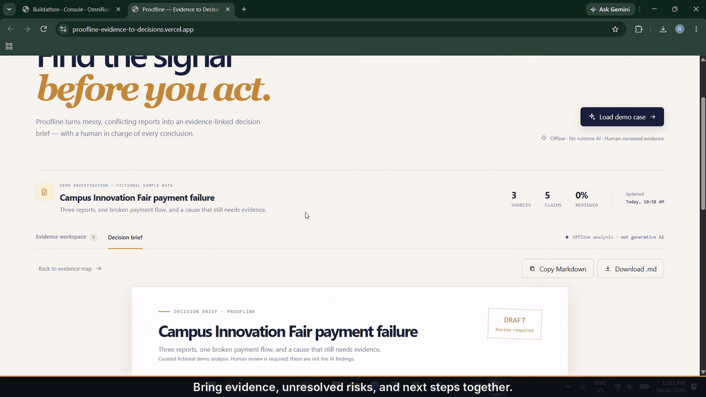

# Proofline — Evidence to Decisions

Proofline is a local, human-in-the-loop evidence workspace for overlapping, incomplete, or conflicting reports. Its Evidence Map links claims to source wording, makes uncertainty visible, and produces a reviewable Markdown decision brief.

Built for the **OmniRush Frontier Buildathon 2026, Human × AI track**.

Live application: https://proofline-evidence-to-decisions.vercel.app/

Full captioned demo video: https://drive.google.com/file/d/1Ksmw1OuY-xsBKsgG3oMtedTxgqjCLlA4/view?usp=sharing



The Campus Innovation Fair case is fictional. There is **no runtime AI, model adapter, API key, or external service**. System suggestions and human decisions are distinct; approving a brief does not verify its evidence or mean every claim has been reviewed.

## Run locally

Use **Node 24.13.0** (pinned in `.nvmrc`, `package.json`, and Docker) and its bundled npm. This version satisfies the installed Vite/plugin requirement (`^20.19.0 || >=22.12.0`) and Vitest requirement (`^22.12.0 || ^24.0.0 || >=26.0.0`).

```bash
nvm install
nvm use
npm ci
npm run dev
```

`nvm` commands are optional if Node 24.13.0 is already selected; Windows nvm users can use `nvm install 24.13.0` and `nvm use 24.13.0`. Open the URL printed by Vite. **Load demo case** opens the prepared case; **Reset case** restores the original fictional evidence. Browser local storage retains the case across refreshes on the same origin. No `.env` file is needed; `.env.example` documents this.

## Tests and production build

```bash
npm test
npm run build
npm run preview
```

`npm test` runs Vitest once: 10 analysis tests and 12 React interaction tests. Coverage includes curated demo matching, conservative extraction, source excerpts, human overrides, approval invalidation, report CRUD, search, storage validation/persistence, stale-source removal, clipboard failure, download creation, dialog focus/Escape, and resetting the demo. React interactions run in jsdom, not a real browser. Tests and builds need installed dependencies but no runtime network access. `npm ci` initially needs registry access or a complete dependency cache.

`npm run build` produces `dist/`; `npm run preview` serves that build locally for inspection.

Latest local checks: `npm test` passed 2 files / 22 tests and `npm run build` succeeded. Both also passed under the exact pinned Node 24.13.0 runtime using npm's executable-package runner. The CRUD test was made faster by scoping DOM queries and passes under the default Vitest five-second timeout; two consecutive full-suite runs passed. A fresh Git clone installed with `npm ci --offline --no-audit --no-fund` from the local dependency cache, passed all tests, and built successfully. This cache-only install is not an OS-level network-isolation test. The built-in browser tab still requires access approval, so the real-browser visual/responsive walkthrough remains unverified. See `VERIFICATION.md` for the exact evidence and gaps.

## Docker and offline verification

The dependency stage uses Node 24.13.0 and `npm ci`. The `test` target retains installed dependencies and runs tests when the container starts. The final `web` target serves only static build output with unprivileged nginx on port 8080 (UID 101).

```bash
docker build --target test -t proofline-test .
docker run --rm --network none proofline-test
docker build -t proofline .
docker run --rm -p 8080:8080 proofline
```

Open <http://localhost:8080>. Building images requires access to base images and npm packages unless already cached. The separate `docker run --rm --network none proofline-test` command verifies tests with container networking disabled **after** dependencies are installed; it does not claim the initial image build is offline. Check its exit code is zero. Static web serving can then be inspected using the published port and the browser's offline mode after loading the app.

**Docker verification status:** verified in `VERIFICATION.md`. `docker build --target test -t proofline-test .` and `docker run --rm --network none proofline-test` passed all 22 tests with container networking disabled at runtime, and `docker build -t proofline .` plus `docker run --rm -p 8080:8080 proofline` served HTTP 200 from the production image.

## How analysis and review work

- **Exact demo:** curated claims are returned only when the complete report set has the demo's exact IDs and text. Report order and metadata do not determine this match. These are prepared fictional findings, not live semantic analysis.
- **Edited/new reports:** other report sets use deterministic sentence extraction. Punctuation/newlines split source text into trimmed excerpts; each suggestion links to its source and begins **Unverified**, unreviewed, with manual review required. This is conservative extraction, not semantic verification, contradiction detection, deduplication, or causal reasoning.
- **Source changes:** adding, editing, or removing reports rebuilds suggestions for the current source set and clears brief approval. Previous claim-level review decisions are replaced by the rebuilt suggestions; original curated claims return only for the exact demo set.
- **Human review:** edit claim wording, choose a status, and add notes while retaining original source excerpts. Review progress measures explicitly reviewed claims, not truth or confidence. Irrelevant claims are excluded from the brief.
- **Approval:** claim/status/note changes and source changes invalidate prior approval. Approval is a local reviewer flag, not an authenticated signature or immutable audit trail. Unreviewed or unresolved active claims remain open risks even in an approved brief.
- **Export:** Markdown includes the method, citations/excerpts, human notes, approval state, and uncertainty. Missing-information prompts can have no attached excerpt; they are not verified facts.

## Architecture

```text
React + Vite
  ├── src/data.js           fictional demo reports and curated claims
  ├── src/analysis.js       deterministic extraction, validation, review, brief/export
  ├── src/analysis.test.js   offline analysis/workflow logic tests
  ├── src/workflow.test.jsx  React/jsdom interaction regression tests
  ├── src/main.jsx          browser workspace and local persistence
  └── src/styles.css        responsive workspace styling
```

There is no backend or existing AI integration. Application state stays in this browser's local storage; this is not a multi-user or server-backed workspace.

## Two-minute demo walkthrough

1. Open Proofline and use **Reset case** to start from the original case.
2. Select **A network failure caused the payment terminal outage** in the Evidence Map.
3. Compare the terminal error, normal nearby Wi-Fi, and unrelated later network restart excerpts. The curated suggestion is **Conflicting**, not a proven cause.
4. Select **The terminal may have run out of battery**, mark it **Unverified**, and add a review note requesting battery evidence.
5. Open **Decision brief** and show the updated note, citations, and unresolved risks.
6. Click **Approve decision brief**. Explain that approval retains uncertainty and does not assert every claim was reviewed.
7. Edit a claim or source and show approval returning to draft. Source edits replace curated claims with unverified sentence excerpts.
8. Use **Copy Markdown** or **Download .md** to inspect the exported brief. Clipboard access depends on browser permissions; download is available if copying is blocked.

This is a suggested script, not evidence that a recording exists or that the walkthrough has been verified in a browser.

## Eight delivery requirements — evidence and status

These track the project's eight delivery items, not a certification against official competition rules.

| # | Requirement | Status / evidence |
| --- | --- | --- |
| 1 | Git repository and milestones | Initialized with application and private-config exclusion commits, followed by review/test hardening. No remote repository or submission has been created. |
| 2 | Dependency lockfile | `package-lock.json` is included; package versions are exact and root runtime metadata matches `.nvmrc`. |
| 3 | Runtime pin | Node 24.13.0 aligned in `.nvmrc`, `package.json` engines, and the Docker dependency stage; supported by installed tool engine ranges. |
| 4 | Dockerfile | Dependency, runnable test, build, and non-root static web stages provided. `VERIFICATION.md` records successful Docker test-target and production-image checks. |
| 5 | Offline test entry point | `npm test` runs the installed Vitest logic suite; `VERIFICATION.md` also records a passing network-isolated Docker test run (`docker run --rm --network none proofline-test`) after image build. |
| 6 | Documentation | Setup, actual npm commands, analysis behavior, limitations, demo script, and verification procedure are documented here. |
| 7 | Environment template | `.env.example` states that no configuration is required; no unused credential variables imply a working adapter. |
| 8 | Portability | Relative application paths, a lockfile, and runtime/container pins are supplied. Cross-platform execution has not been comprehensively verified. |

**Official buildathon reference:** [Frontier Buildathon 2026 beginner's guide](https://omnirush.ai/buildathon) was checked on October 19, 2026. It states that submissions close **20 October at 11:59 PM IST**; the required destination is the OmniRush buildathon dashboard, where entrants add their track, public GitHub repository, and OmniRush sessions, then copy the resulting Submission ID into Unstop. The guide says the repository must be public and belong to the connected GitHub account. A demo video and live link are optional; a 2–3 minute video is recommended. It requires OmniRush to be the only generative AI tool, solo participation, recorded OmniRush sessions, a README, lockfile, pinned runtime, Dockerfile, offline test command, `.env.example`, and no machine-specific paths. It does **not** require runtime AI in the submitted product; the product can be an offline build, but the build must be made with OmniRush. Verify the dashboard and current official page immediately before submission because deadlines and forms are authoritative at the server.

## Known limitations

- Text reports only; no file ingestion, OCR, external data retrieval, or model inference.
- Sentence splitting is intentionally simple and may split abbreviations or decimals; unverified excerpts require human interpretation.
- The curated recommendation applies to the exact fictional demo only. Other reports require manual review and supporting evidence.
- Local storage is browser/origin-specific and is not a backup. Export important briefs; resetting the case replaces local edits.
- Human review and approval are local UI state, not identity verification, access control, or a tamper-proof audit log.
